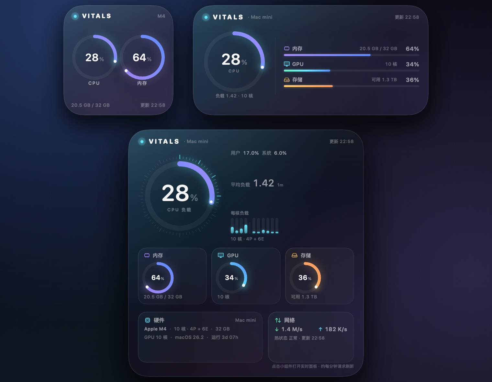
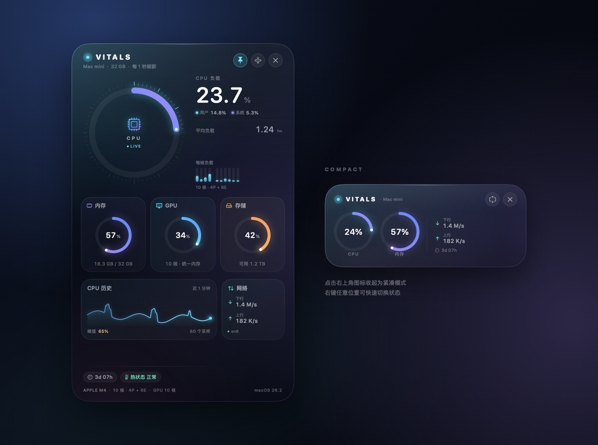

# VITALS · macOS 桌面硬件仪表

VITALS 是一个原生 macOS 硬件监控小组件：把 CPU、内存、GPU、存储和网络状态，做成和系统「日历 / 天气」小组件一样、可以直接放在桌面上的 Widget。

同时附带一个可选的实时仪表面板：桌面小组件由系统调度刷新，点击小组件（或菜单栏图标）即可打开 1 秒级刷新的完整仪表。实时面板也能直接固定在桌面上，无需签名即可获得类似桌面组件的体验。



> 项目包含完整的 WidgetKit 扩展。macOS 系统小组件必须由 Apple Development / Developer ID 签名才会进入「编辑小组件」图库；本地 ad-hoc 构建可直接使用固定在桌面的实时面板。详见下文「系统小组件签名说明」。

## 功能

- **真正的 WidgetKit 桌面小组件**：小、中、大三种尺寸，通过 macOS 自带的「编辑小组件」添加到桌面。
- **CPU**：总占用率、用户/系统占比、平均负载、每个核心的实时负载条。
- **内存**：已用/总量、App / 联动 / 压缩内存详情与交换空间提示。
- **GPU**：Apple Silicon 统一 GPU 利用率与 GPU 核心数。
- **存储**：APFS 卷容量、可用空间。
- **网络**：实时下行 / 上行速率。
- **硬件信息**：芯片型号、P 核 / E 核数量、GPU 核心数、统一内存容量、macOS 版本、开机时长、热压力。
- **实时面板**：1 秒刷新、CPU 历史曲线、桌面悬浮 / 置顶、紧凑模式。
- **菜单栏**：常驻 CPU 百分比，点击展开控制菜单。
- **原生实现**：SwiftUI + WidgetKit + Mach / IOKit；无第三方依赖，无网络请求，不上传任何数据。

## 系统要求

- macOS 14 Sonoma 或更新版本
- 构建需要 Xcode 15+（本项目在 Xcode 26 / macOS 26 上验证）
- 同时支持 Apple Silicon 与 Intel（构建脚本输出 Universal App）

## 运行

```bash
./scripts/run.sh
```

或直接双击：

```bash
open dist/VITALS.app
```

首次启动会弹出使用说明。实时面板默认固定在桌面（位于普通窗口之下、桌面图标之上），点击右上角图钉可以切换为悬浮。

## 把 VITALS 放到桌面

1. 先启动一次 VITALS（让 macOS 注册小组件）。
2. 在桌面空白处 **右键 → 编辑小组件…**。
3. 在小组件库中搜索 **VITALS**（或「硬件」）。
4. 选择小 / 中 / 大尺寸，拖到桌面。
5. 点击桌面小组件，可打开实时仪表盘。

如果小组件库暂时搜索不到：

- 完全退出 VITALS 后重新打开一次；
- 或在终端执行：

```bash
pluginkit -a "$PWD/dist/VITALS.app/Contents/PlugIns/VITALSWidget.appex"
open dist/VITALS.app
```

> 桌面小组件由 macOS WidgetKit 调度刷新。VITALS 会向系统请求大约每分钟更新一次，但实际刷新时间由系统决定；小组件右下角会显示数据时间。需要秒级实时数据时，点击小组件打开实时面板。

### 系统小组件签名说明

macOS 只会加载由 Apple Development 或 Developer ID 签名的 WidgetKit 扩展。仓库附带的本地构建使用 ad-hoc 签名，方便直接运行；如果它没有出现在「编辑小组件」图库中，这是签名限制，不是数据或界面问题。

要在系统图库中使用：

1. 在 Xcode 中登录你的 Apple ID，并在 `Settings → Accounts` 添加开发者账号。
2. 打开 `VITALS.xcodeproj`，分别选中 `VITALS` 与 `VITALSWidget` 两个 target。
3. 在 **Signing & Capabilities** 中勾选 **Automatically manage signing**，选择你的 Team；如有冲突，给两个 target 换成你自己的唯一 Bundle Identifier。
4. 从 Xcode 运行一次，或 Archive 后把 App 放进 `/Applications`。
5. 右键桌面 →「编辑小组件…」→ 搜索 VITALS。

无需签名也能立即使用的替代方案：实时面板默认固定在桌面。它是原生 AppKit 窗口，渲染在桌面图标之上、普通窗口之下，效果与桌面组件类似；点击菜单栏波形图标 →「窗口层级」可以在桌面与悬浮之间切换。

## 实时面板与菜单栏

- **拖动**：拖动任意空白处移动窗口。
- **图钉按钮**：在「悬浮于窗口之上」和「固定在桌面」之间切换。
- **压缩按钮**：切换紧凑模式。
- **关闭按钮**：隐藏面板，菜单栏图标继续常驻。
- **右键面板**：隐藏、置顶、紧凑、退出。
- **菜单栏波形图标**：查看 CPU、打开/隐藏面板、切换紧凑模式、切换「桌面 / 悬浮」层级、修改刷新频率、重置位置、添加小组件帮助。
- **Cmd+Q**：退出。



## 数据来源

| 指标 | 实现 |
| --- | --- |
| CPU 总占用 / 单核 | `host_processor_info` 两次采样求差分 |
| 用户 / 系统 / 空闲 | CPU tick 差分 |
| 平均负载 | `getloadavg` |
| 内存 | `host_statistics64` + `vm.swapusage` |
| GPU | IORegistry `IOAccelerator.PerformanceStatistics` |
| 磁盘 | APFS 卷资源值（含重要用途可用空间） |
| 网络 | `getifaddrs` 收发字节差分 |
| 硬件型号 | `sysctl`、`hw.perflevel*`、IORegistry |
| 热压力 / 低电量模式 | `ProcessInfo` |
| 电池（如有） | IOKit Power Sources |

Widget 扩展运行在 App Sandbox 中，以上 API 均已在沙盒环境中验证。

## 构建

```bash
./scripts/build.sh
```

产物位于：

```text
dist/VITALS.app
└── Contents/PlugIns/VITALSWidget.appex
```

构建脚本使用 `xcodebuild` 编译 Universal App，并对本地开发包进行 ad-hoc 签名。项目工程文件已提交；如需修改 `project.yml` 后重新生成：

```bash
brew install xcodegen
./scripts/project.sh
```

### 其他脚本

```bash
./scripts/preview.sh   # 生成应用、桌面小组件、实时面板预览图到 docs/
./scripts/metrics.sh   # 输出一次真实的硬件采样，便于验证数据
```

## 目录结构

```text
Sources/
├── Vitals/
│   ├── App/          # 菜单栏、实时面板、窗口控制、启动入口
│   ├── System/       # Mach / IOKit 硬件采样与数据模型
│   ├── UI/           # 实时面板的 SwiftUI 仪表组件
│   └── Preview/      # 离屏预览图渲染
└── Widget/
    ├── VitalsHomeWidget.swift   # WidgetKit 入口与 TimelineProvider
    ├── WidgetViews.swift        # 小 / 中 / 大尺寸小组件 UI
    └── WidgetModel.swift        # 小组件展示模型
Resources/
├── App-Info.plist
├── Widget-Info.plist
├── VITALSWidget.entitlements
└── AppIcon.icns
```

## 隐私

- 所有数据均在本机通过系统 API 读取。
- 没有网络请求、分析 SDK 或账号系统。
- 不读取文件内容、不访问浏览器数据、不记录进程列表。
- 桌面小组件只展示用户可见的硬件状态。

## 已知限制

- WidgetKit 不允许秒级刷新，桌面小组件以系统调度为准；实时读数请使用实时面板。
- 应用为本地 ad-hoc 签名。若将打包后的 App 传到其他 Mac，首次打开可能需要在「系统设置 → 隐私与安全性」中允许，或右键选择「打开」。
- 某些 Intel Mac 或外接 GPU 配置可能不提供 GPU 利用率；界面会显示「不可用」。
- 电池、热压力等字段只在设备提供时显示。
